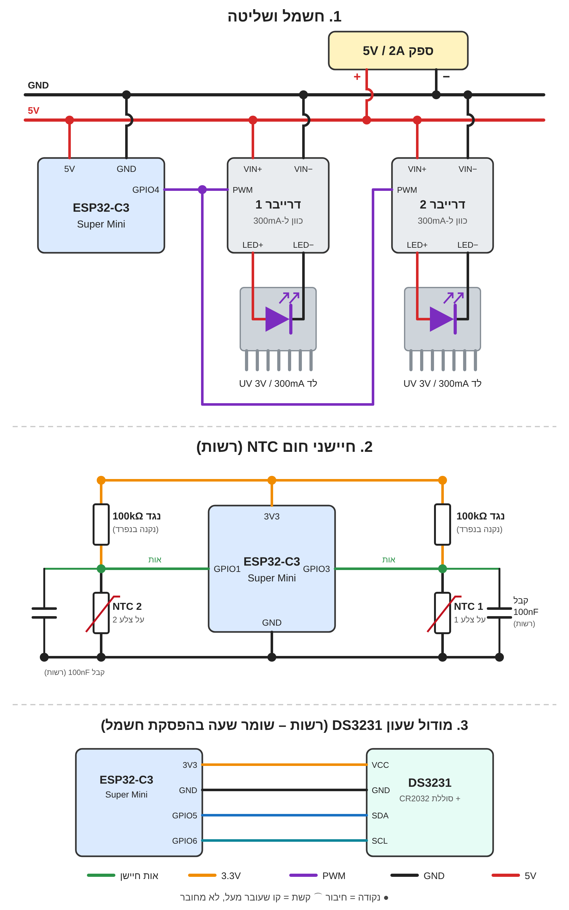

<div dir="rtl">

# שעון שבועי לנורת UV – ESP32 Super Mini

בקר ESP32 שעובד **בלי אינטרנט ובלי רשת ביתית**. הבקר פותח רשת Wi‑Fi משלו, ומתחברים אליה מהטלפון. דף הניהול (באנגלית) נפתח אוטומטית, ובו:
- רואים את השעה בבקר, ומכוונים אותה מהטלפון בלחיצה אחת או ידנית.
- יוצרים אירועים: ימים, שעת התחלה, משך, עוצמה, והדלקה/כיבוי מיידיים או בפייד (Fade).
- רואים מבט שבועי, סטטוס נוכחי ואת האירוע הבא.

ההגדרות נשמרות בזיכרון הבקר ולא נמחקות בניתוק חשמל.

## דיאגרמת חיבורים



## ✅ החומרה המומלצת: דרייבר 2.8–6V עם PWM (‏30–1500mA)

דרייבר זרם קבוע שעובד ישירות מ-5V, מתאים ללד UV של 3.3V, והעוצמה נשלטת ב-PWM. **זו הדרך המומלצת לפרויקט ב-5V** במקום LD24AJTA.

```
ספק 5V (+) ──┬── VIN+ (דרייבר)          LED+ ── (+) לד UV
             └── 5V   (ESP32)           LED− ── (−) לד UV
ספק 5V (−) ──┬── VIN− (דרייבר)
             └── GND  (ESP32)
GPIO4 (ESP32) ── PWM (דרייבר)
```

לפני שמפעילים:
1. **לכוון זרם לפני חיבור הלד:** מסובבים את הפוטנציומטר לזרם המינימלי, מחברים את הלד עם מולטימטר בטור (מצב A) ומעלים בהדרגה עד הזרם של הלד (למשל 350mA ללד 1W, ‏700mA ללד 3W). אסור לעבור את דירוג הלד.
2. **מתח הלד חייב להיות נמוך ממתח הכניסה.** הדרייבר רק מוריד מתח, ולכן על 5V הלד צריך להיות עד בערך 4.5V. לד של 3.3V מתאים.
3. **ספק:** 5V עם 2A לפחות. ב-5V ההספק המעשי הוא בערך 5W, לא 9W.
4. **PWM:** במצב רגיל, יותר PWM = יותר אור. אם זה הפוך, משנים את "היפוך PWM" בדף. אם העוצמה קופצת או מהבהבת, מורידים את התדר בדף ל-500Hz או 200Hz.
5. **הבהוב בהדלקה:** אם הלד נדלק לרגע כשמחברים חשמל, מוסיפים נגד 10kΩ בין קו ה-PWM ל-GND.
6. **חום:** מעל בערך 700mA כדאי קירור ללד (גוף קירור) ומקום מאוורר לדרייבר.

אפשר לחבר כמה לדים במקביל (כל אחד 2.8–6V), כל עוד הזרם הכולל לא עובר 1.5A.

### התצורה המומלצת: דרייבר נפרד לכל לד (3V / ‏300mA)

הכי טוב: כל דרייבר מכוון ל-**280–300mA**, ואין צורך בנגדי איזון.

```
ספק 5V (+) ──┬── VIN+ דרייבר 1 ── לד 1
             ├── VIN+ דרייבר 2 ── לד 2
             └── 5V   (ESP32)
ספק 5V (−) ── VIN− של שני הדרייברים + GND (ESP32)
GPIO4 ──┬── PWM דרייבר 1
        └── PWM דרייבר 2
```

### הגנת חום עם חיישן NTC (כמו במדפסת תלת מימד)

חיישן: **NTC 100K, ‏B3950**, בגרסת חרוז זכוכית (~2 מ"מ) או SMD. ה-NTC מגיע בלי נגד, אז לכל חיישן צריך לקנות בנפרד **נגד 100kΩ** (עדיף 1%).

```
3.3V ── 100kΩ ──┬── GPIO3 (חיישן 1)      3.3V ── 100kΩ ──┬── GPIO1 (חיישן 2)
                └── NTC ── GND                           └── NTC ── GND
```
(אופציונלי: קבל 100nF בין ה-GPIO ל-GND לקריאה יציבה יותר.)

- מדביקים את ה-NTC על צלע הקירור, צמוד לבסיס הלד: סרט קפטון, או דבק טרמי עם משחה טרמית.
- בדף, בהגדרות: בוחרים כמה חיישנים מחוברים (1 או 2) ומגדירים טמפרטורה מקסימלית (ברירת מחדל 50°C).
- מעל הגבול העוצמה יורדת בהדרגה עד שהטמפרטורה מתייצבת, וכשהצלע מתקררת העוצמה חוזרת. אם הטמפרטורה עוברת את הגבול ב-15°C, הלד נכבה מיד.
- חיישן מנותק או תקול → העוצמה מוגבלת ל-30% ומוצגת אזהרה בדף.
- NTC של 10K: משנים בקוד את `NTC_R25` ואת `NTC_RFIXED` ל-10000, ומחברים נגד של 10kΩ.

### חלופה: 2 לדים של 3V / ‏300mA על דרייבר אחד

- **במקביל, לא בטור:** בטור צריך 6V, יותר מכניסת ה-5V.
- **נגד איזון לכל לד:** ‏1Ω, ‏0.5W בטור לכל לד. בלי זה לד אחד יכול למשוך את רוב הזרם ולהישרף.
- **לכוון את הדרייבר ל-550–600mA בסך הכל** (בערך 275–300mA לכל לד). עם 550mA יש קצת מרווח ביטחון.
- **לבדוק כל ענף בנפרד עם המולטימטר.** אם ההפרש בין הלדים גדול מ-20%, מגדילים את הנגדים ל-1.5Ω.
- **ספק:** ‏5V / ‏1A מספיק (בערך 0.5A ללדים ועוד הבקר). 2A נותן מרווח.

```
LED+ (דרייבר) ──┬── 1Ω ── (+) לד 1 (−) ──┐
                └── 1Ω ── (+) לד 2 (−) ──┴── LED− (דרייבר)
```

## ⚠️ קונפליקטים בחומרה – לקרוא לפני חיבור (אם משתמשים ב-LD24AJTA)

### 1. הדרייבר LD24AJTA לא יעבוד על 5V (קונפליקט עיקרי)
הדרייבר דורש מתח כניסה של **9V–24V**. על 5V הוא לא יידלק או יעבוד בצורה לא יציבה. יש שלוש דרכים לפתור:

| אפשרות | מה עושים | יתרונות | חסרונות |
|---|---|---|---|
| **א. להישאר ב‑5V בלי הדרייבר (מומלץ אם חייבים 5V)** | מחליפים את LD24AJTA במודול MOSFET לוגי (למשל AO3400 / IRLZ44N) + נגד טורי, או דרייבר זרם קבוע שעובד מ‑5V | פשוט, זול, ספק אחד של 5V | עם נגד יש בזבוז חום קטן |
| ב. ממיר מעלה 5V→12V | מודול Boost (למשל MT3608 או XL6009) מזין את הדרייבר | משתמשים בדרייבר הקיים | עוד רכיב; צריך ספק 5V חזק מספיק |
| ג. ספק 12V | ספק 12V לדרייבר + ממיר מוריד 12V→5V (למשל Mini‑360 / MP1584) לבקר | הדרך "הנכונה" לדרייבר הזה | הפרויקט כבר לא 5V |

**חישוב נגד לאפשרות א'** (לד 3.3V על 5V): `R = (5 − 3.3) / I`
- לד קטן 20mA → בערך **82–100Ω**
- לד 1W (‏350mA) → בערך **4.7Ω, נגד של 1W לפחות**
- לד 3W (‏700mA) → בערך **2.2Ω, נגד של 2W** – כאן עדיף דרייבר זרם קבוע

### 2. התאמת זרם – סכנה ללד
LD24AJTA הוא דרייבר 20W. יש לוודא בדף הנתונים שלו שזרם היציאה מכוון לזרם המקסימלי של לד ה‑UV שלך. אם זה לד קטן (3mm/5mm, ‏20mA) – הדרייבר הזה לא מתאים בכלל והוא ישרוף אותו. **בדוק כמה וואט/מיליאמפר הלד שלך לפני חיבור.**

### 3. רמת אות PWM
יציאת ה‑ESP32 היא **3.3V**. חלק מהדרייברים צריכים אות של 5V או יותר בכניסת ה‑PWM/DIM. אם הלד לא מגיב לשינויי עוצמה – צריך טרנזיסטור או ממיר רמות. אם הדרייבר עובד הפוך (100% = כבוי) – יש בדף הניהול הגדרה "היפוך PWM". גם את תדר ה‑PWM אפשר לשנות מהדף (ברירת מחדל 1000Hz).

### 4. הזנת 5V ל‑Super Mini
- מחברים 5V לפין **5V** בלבד, לא לפין 3.3V.
- לא לחבר USB וספק חיצוני של 5V בו זמנית בלי דיודה.
- **GND משותף** בין הבקר, הדרייבר/MOSFET והספק – חובה.

### 5. פינים שאסור להשתמש בהם
ב‑ESP32‑C3 Super Mini הפינים GPIO2, GPIO8, GPIO9 הם פיני אתחול (Strapping). הקוד משתמש ב‑**GPIO4**.

### 6. שעון ללא אינטרנט
לבקר אין חיבור לאינטרנט, ולכן השעה נלקחת מהטלפון. בלי מודול שעון, **אחרי הפסקת חשמל השעה נמחקת**, ועד שנכנסים לדף ומכוונים אותה האירועים לא פועלים (הלד נשאר כבוי – מצב בטוח). כשנכנסים לדף והשעה לא מכוונת, היא מכוונת אוטומטית מהטלפון.

**מומלץ להוסיף מודול DS3231** (‏~10 ש"ח, עם סוללת CR2032). הוא שומר את השעה גם בהפסקת חשמל, והקוד מזהה אותו אוטומטית. חיבור: VCC→3V3, ‏GND→GND, ‏SDA→GPIO5, ‏SCL→GPIO6 (חלק 3 בדיאגרמה).

**שעון קיץ/חורף:** הבקר לא משנה שעה לבד. אחרי מעבר שעון לוחצים **Sync with phone**. הדף מציג "Differs from phone" כשיש הפרש מהטלפון.

### 7. בטיחות UV
אור UV מזיק לעיניים ולעור. לא להסתכל ישירות לנורה.

## חיבור מומלץ ל‑5V (אפשרות א')

```
ספק 5V (+) ──┬──────────── 5V  (ESP32 Super Mini)
             │
             └── נגד ── (+) לד UV (−) ── Drain  (MOSFET)
                                         Gate   ── GPIO4  (דרך נגד 100Ω, ונגד 10kΩ ל-GND)
ספק 5V (−) ──────────────────────────── Source (MOSFET) ── GND (ESP32)
```

## חיבור עם הדרייבר הקיים (אפשרות ב' או ג')

```
12V (מספק או מממיר מעלה) ── VIN+ (LD24AJTA)      LED+ / LED− ── לד UV
GND ─────────────────────── VIN− (LD24AJTA) ── GND (ESP32)
GPIO4 (ESP32) ───────────── PWM/DIM (LD24AJTA)
```

## התקנה

1. Arduino IDE → Boards Manager → להתקין **esp32 by Espressif**. לא צריך ספריות נוספות.
2. לפתוח את `uv_timer/uv_timer.ino`.
3. Board: **ESP32C3 Dev Module**, ‏USB CDC On Boot: **Enabled**.
4. Upload. (אם לא מזהה – להחזיק BOOT, ללחוץ RESET, לשחרר BOOT.)

## שימוש

1. מחברים את הטלפון לרשת **UV-Timer** (סיסמה `uvtimer123`). הדף אמור להיפתח לבד. אם לא, נכנסים בדפדפן ל-`http://192.168.4.1`.
   - באנדרואיד ייתכן שתופיע הודעה "לרשת אין אינטרנט". בוחרים **להישאר מחובר**. אם הדף לא נטען, כדאי לכבות זמנית את הנתונים הסלולריים.
2. **Device clock**: בכניסה הראשונה השעה מכוונת אוטומטית מהטלפון. אפשר גם ללחוץ **Sync with phone** או **Set manually**.
3. **Events** ← **+ Add event**:
   - **Days**: ימים בשבוע (יש קיצורים: Every day, Mon–Fri, Sun–Thu).
   - **Start time** ו-**Duration** (שעות ודקות, עד 24 שעות). אירוע יכול להימשך אחרי חצות.
   - **Brightness**: עוצמה.
   - **Turn on / Turn off**: ‏Instant (מיידי) או Fade (הדרגתי), ו-**Fade length** בדקות. הפייד קורה בתוך משך האירוע.
   - כל אירוע נשמר בבקר מיד בלחיצה על Save. המתג ליד כל אירוע משהה אותו בלי למחוק.
4. **מצב**: ‏Schedule (לפי האירועים) / Always on (ידני, עם עוצמה) / Off.
5. **Settings**: הגבלת עוצמה מקסימלית, חיישני חום ומגבלת טמפרטורה, תדר והיפוך PWM, ושם וסיסמה של רשת ה-Wi‑Fi.

הערות:
- אירועים חופפים → נבחרת העוצמה הגבוהה מביניהם.
- עד 20 אירועים.
- כדאי לשנות את סיסמת הרשת ב-Settings.

</div>
